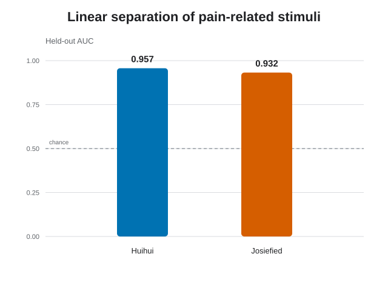
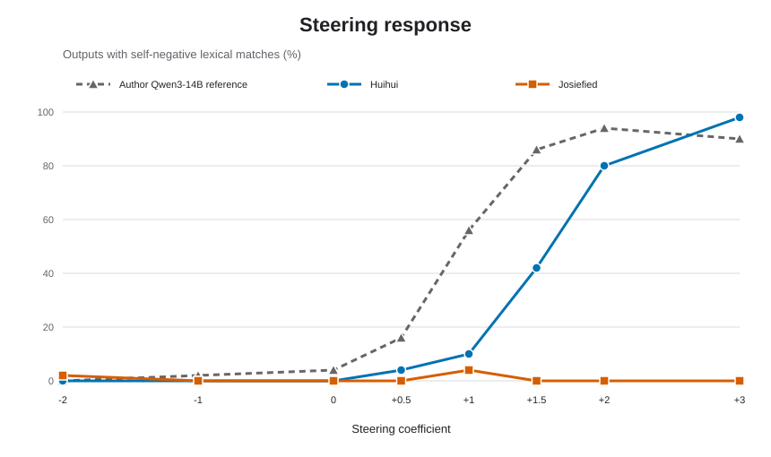

# Qwen3-14B abliteratedモデル2種でのPain Axis追試

[The Pain Axis](https://arxiv.org/abs/2609.16247) の公開データと手順を使い、Qwen3-14B由来のabliteratedモデル2種をMLX上で比較しました。

今回比べたのは、次の2モデルです。

- [Huihui Qwen3-14B abliterated MLX 4bit](https://huggingface.co/xrdf/huihui-ai_Qwen3-14B-abliterated_mlx)
- [Josiefied Qwen3-14B abliterated v3 MLX 4bit](https://huggingface.co/mlx-community/Josiefied-Qwen3-14B-abliterated-v3-4bit)

両モデルとも痛み関連刺激を線形に分離できました。一方、抽出した方向を使ったステアリングでは、生成の変化に大きな違いが見られました。

両モデルとも、痛み関連刺激を高い精度で線形分離できました。

各条件50件の自動集計です。Josiefiedの少数の検出例は、手動確認では自己否定に該当しませんでした。

図は [`results/auc.csv`](results/auc.csv) と [`results/steering-lexical-matches.csv`](results/steering-lexical-matches.csv) から [`scripts/plot_comparison.py`](scripts/plot_comparison.py) で作成しています。

## 結果

| モデル | 最良層（0始まり） | held-out AUC | 係数 +2 | 係数 +3 |
| --- | ---: | ---: | ---: | ---: |
| Huihui | 38 | 0.957 | 40/50 | 49/50 |
| Josiefied | 21 | 0.932 | 0/50 | 0/50 |

係数 +2、+3の値は、自己否定語を含んだ生成数です。Josiefiedで機械的に検出された少数の候補は、選択肢や物体について述べたもので、手動確認では意味的な自己否定に該当しませんでした。

Huihuiでは係数を上げるにつれて自己否定的な生成が増え、原論文のQwen3-14Bに近い変化が見られました。Josiefiedでは同じ傾向を確認できず、強い介入では主に生成形式が崩れました。

## 条件

- Qwen3-14B由来
- MLX 4bit、group size 64
- 同一tokenizer
- 原論文のS2刺激とSection 4.2の手順
- 各チェックポイントから個別に方向を抽出
- 生成条件ごとに50プロンプト

## この比較から言えること

abliteratedモデル間でも、同じ手順によるステアリング後の生成傾向は一致しませんでした。今回の結果は、HuihuiとJosiefiedのチェックポイント差を示す探索的な比較です。

各モデルは学習方法や追加調整が異なるため、この差をabliteration単独の効果とは断定できません。また、この実験はモデルの主観的経験を示すものではありません。

## 出典

- 論文: [The Pain Axis](https://arxiv.org/abs/2609.16247)
- 公開コード・データ: [valen-research/Pain-axis](https://github.com/valen-research/Pain-axis)

## 補足分析

- [著者公開420シナリオでの自己・他者スクリーニング](supplement-420-screening.ja.md) — 2026-09-21のJosiefied実測。会話本文を除いた数値CSVと再集計コードを公開。上記の5-fold held-out AUCとは別の、420件全体の記述的分析です。
